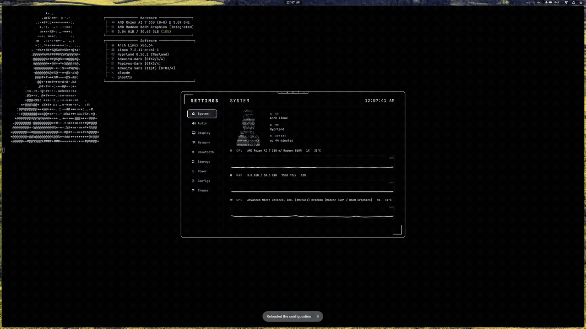
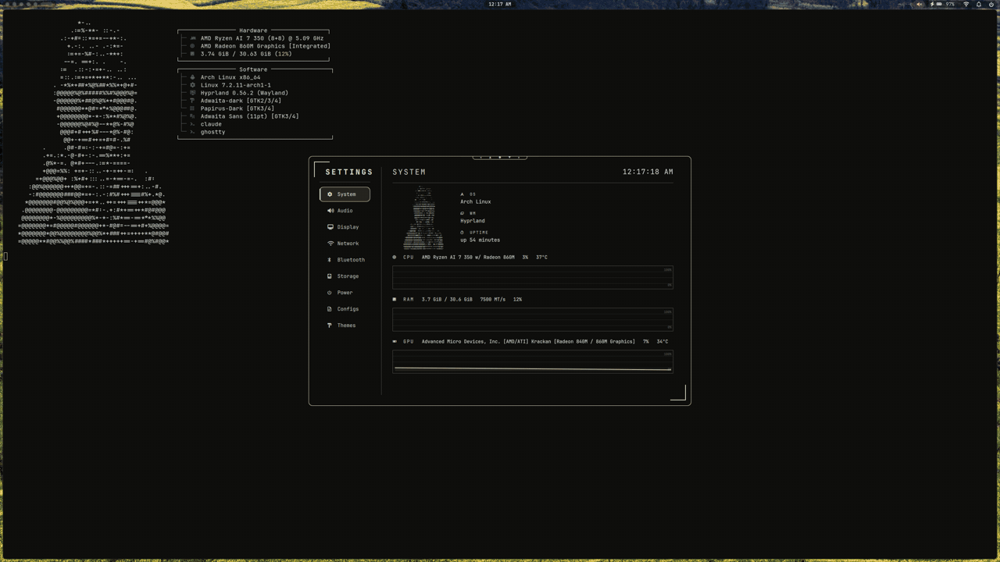
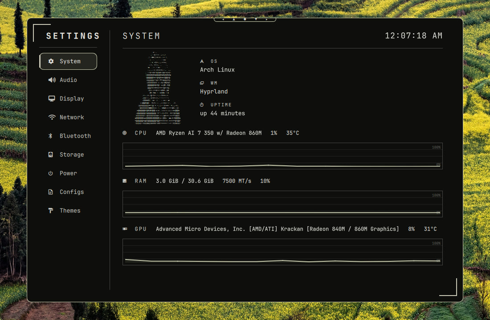
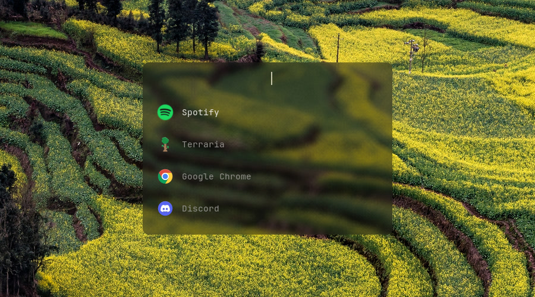
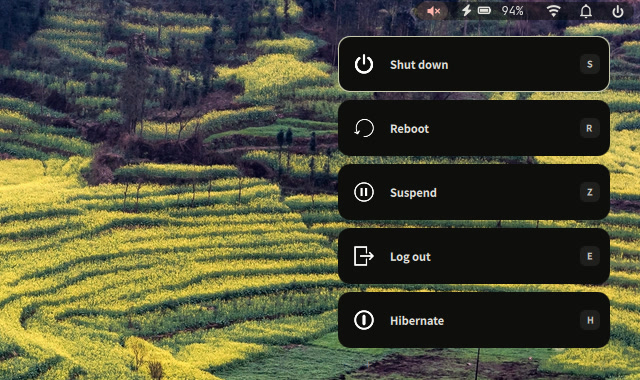
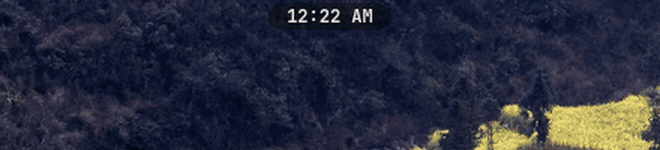
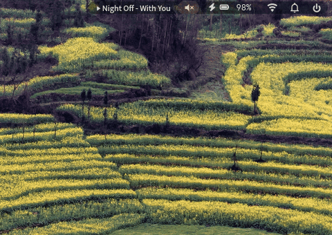

<div align="center">

## jinhobh's Hyprland dotfiles

A monochrome Hyprland + Quickshell desktop with dynamic, wallpaper-driven colors.
Built on top of [43PR/dotfiles](https://github.com/43PR/dotfiles).


### **[Screenshots](#screenshots) - [What's different](#whats-different-from-upstream) - [Keybinds](#keybinds) - [Installation](#installation) - [Updating](#updating)**

</div>


## Screenshots

### Theme presets
Switch the colors across the whole desktop (bar, terminal, settings, lock screen, rofi, GTK, btop, cava) with one command. You can also generate a palette from your wallpaper.



```bash
theme preset nord                               # any file in .config/43pr/themes/
theme wallpaper ~/Pictures/Wallpapers/foo.jpg   # colors generated from the image
theme toggle                                    # light / dark
```

### Wallpaper picker (`Super + P`)
Scroll through your wallpapers and click one to apply it. The whole desktop then rethemes from the new image. In this clip the terminal background and the settings accents change to match.



### Settings menu (`Super + I`)
System stats, audio, display, network, bluetooth, storage, power, configs and themes.



### Launcher (`Super + D`) and power menu (``Super + ` ``)

<p>
  
  
</p>

### Volume and brightness OSD
A slider pops up under the bar when you change the volume (including mute) or the screen brightness.



### Media popup
While music is playing, the track shows in the bar. Hover over it to open a card with the album art, a live visualizer and playback controls. The card closes when you move away. Works with Spotify and any other MPRIS player.



## Features

- **Top bar**: clock, media with a scrolling title (hover it for a popup), volume, battery, wifi, notifications. Right-click the clock for bar settings (position, style, modules).
- **Volume and brightness OSDs**: sliders pop up when you use the media or brightness keys.
- **Settings menu**: system, network, bluetooth, display, audio, storage, power, configs, themes.
- **Wallpaper picker** ([hyprquickpaper](https://github.com/iamsurjog/hyprquickpaper)) with automatic color generation.
- **18 preset themes**: monochrome default, Nord, Tokyo Night, Catppuccin, Rosé Pine, Everforest, Dracula, Kanagawa and more.
- **Rofi** for the app launcher and clipboard history. **Quickshell** for the wheel launcher, power menu, notes/to-do and notifications.
- **Hyprlock** lock screen, **zsh + starship** prompt, **Spicetify** theme for Spotify.
- **Optional greetd login screen** with an animated ASCII greeter (see [`greeter/`](greeter)).

> All packages: [packages.txt](packages.txt)

## What's different from upstream

- **Ghostty** is the default terminal (kitty is still installed). Its theme is generated alongside the others.
- A plain **Neovim** config with no plugins (`.config/nvim/init.lua`) that uses the terminal's colors.
- **Keybind changes**: terminal on `Super+X`, wallpapers on `Super+P`, screenshots on `Super+Delete`, vim-style focus/move/resize on H/J/K/L, **3-finger swipe** to switch workspaces.
- **Laptop support**: brightness keys (set through logind, so you don't need the `video` group), brightness OSD, touchpad natural scroll, lower pointer sensitivity.
- **Korean input** via ibus.
- **Quickshell**: volume/brightness slider OSDs, a media hover popup, Bluetooth fixes, lower CPU and memory use, 12-hour clock.
- **greetd greeter** with an animated ASCII login screen.

## Keybinds

| Keybind | Action |
| --- | --- |
| `Super + X` | Terminal (Ghostty) |
| `Super + Q` | Close window |
| `Super + D` | App launcher (rofi) |
| `Super + S` | Wheel launcher |
| `Super + E` | File manager (Thunar) |
| `Super + B` | Browser (Firefox) |
| `Super + I` | Settings menu |
| `Super + P` | Wallpaper picker |
| `Super + V` | Clipboard history |
| `Super + C` | Notes / to-do |
| `Super + N` | Notifications |
| `Super + O` | Cycle window opacity |
| `Super + L` | Toggle light / dark theme |
| `Super + Space` | Toggle floating (centered) |
| `Super + F` | Fullscreen |
| `Super + Tab` | Lock screen |
| ``Super + ` `` | Power menu |
| `Super + Shift + W` | Toggle bar |
| `Super + R` | Screen recorder (gpu-screen-recorder) |
| `Super + H / J / K / L` | Move focus |
| `Super + Shift + H / J / K / L` | Move window |
| `Super + Ctrl + H / J / K / L` | Resize window |
| `Super + 1..0` | Switch workspace |
| `Super + Shift + 1..0` | Move window to workspace |
| `Super + Delete` | Screenshot area |
| `Super + Shift + Delete` | Screenshot full screen |
| `Super + Scroll` | Zoom in/out |
| `Super + Shift + E` | Exit Hyprland |
| 3-finger swipe up/down | Previous / next workspace |

Drag windows with `Super + left mouse` and resize them with `Super + right mouse`. The full list is in [`.config/hypr/keybinds.lua`](.config/hypr/keybinds.lua).

## Installation

Works on Arch-based distros (Arch, CachyOS, EndeavourOS, Manjaro…). It's meant for a fresh install. The installer backs up any existing config files it replaces to `~/.config-backups/`.

```bash
sudo pacman -S git
git clone https://github.com/jinhobh/dotfiles.git
cd dotfiles
./install.sh
```

Log out and back in when it finishes. Put wallpapers in `~/Pictures/Wallpapers` and open the picker with `Super + P`.

MP4 files in the same folder appear with still previews and play as muted, looping live wallpapers on all monitors when selected. Playback runs whenever at least one display shows an empty workspace, and pauses only when every display is occupied (including visible special workspaces). Playback uses `mpvpaper` and `ffmpeg` (included in `packages.txt`; existing installs can use `yay -S mpvpaper ffmpeg`). Selecting an image stops video playback. Live wallpapers restore after login, and desktop colors are generated from a video frame. Playback errors are logged in `~/.cache/43pr/video-wallpaper.log`.

> [!important]
> Configs are **symlinked** into `~/.config` from the cloned repo, so don't move or delete the repo afterwards. If you do move it, run `./install.sh` again to repoint the links.

### Just want one piece?
You don't have to install the whole thing. Most configs work on their own:

- Neovim: `.config/nvim/init.lua`
- Ghostty: `.config/ghostty/config.ghostty`
- zsh / starship: `.config/.zshrc`, `.config/starship.toml`
- Theme engine: `.config/43pr/` (`bin/theme.py` + `templates/` + `themes/`)

## Updating

```bash
cd dotfiles
git pull
./update.sh                   # --dry-run, --skip-packages, --skip-theme
./update.sh --restart-shell   # if any .qml files changed
```

## Credits

- [43PR/dotfiles](https://github.com/43PR/dotfiles): the base this setup is built on (bar, settings, theme engine, installer). Go give it a star.
- [hyprquickpaper](https://github.com/iamsurjog/hyprquickpaper): wallpaper selector.
- [text](https://github.com/spicetify/spicetify-themes): Spicetify theme (modified).

MIT licensed. See [LICENSE](LICENSE).
